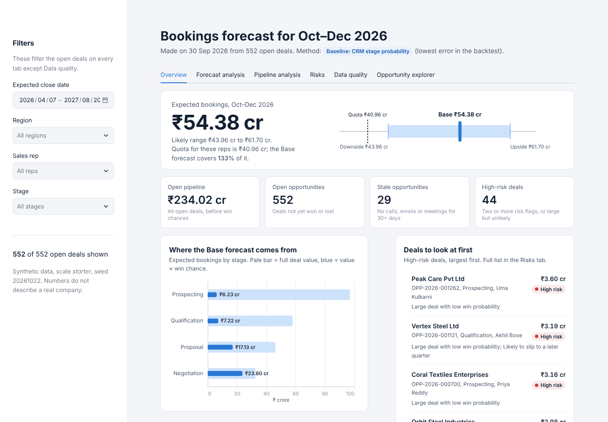

# Sales Forecasting System with Scenario-Based Uncertainty

A complete Python project that forecasts next quarter's sales bookings from
opportunity stage, deal amount, opportunity age, historical conversion rates,
expected close dates and sales-rep activity. It gives **Downside / Base / Upside**
forecasts, checks data quality, flags risky deals, and measures how accurate past
forecasts were.

> **All data is synthetic** (computer-generated with a fixed random seed).
> None of the numbers describe a real company.

| Read this | For |
|---|---|
| [Quick start](#quick-start) | Install, run and verify in about 5 minutes |
| [`docs/DECISIONS.md`](docs/DECISIONS.md) | The reasoning: assumptions, key decisions, trade-offs, testing approach, evidence, limitations |
| [`AI_USAGE.md`](AI_USAGE.md) | How AI (Claude) was used, what it got wrong, and what I reviewed and validated |
| [`PROMPT_HISTORY.md`](PROMPT_HISTORY.md) | Every prompt, word for word |
| [`docs/WALKTHROUGH.md`](docs/WALKTHROUGH.md) | A 10-minute demo script and likely questions |
| Commit history | One commit per development phase, plus separate commits for real fixes and design changes |

## Quick start

Needs **Python 3.11+** and **Git**. Commands are for Windows PowerShell (VS Code
terminal). On macOS/Linux use `python3 -m venv .venv` and `source .venv/bin/activate`.

```powershell
git clone https://github.com/<your-username>/sales-forecasting-system.git
cd sales-forecasting-system
py -m venv .venv
.\.venv\Scripts\Activate.ps1
pip install -r requirements.txt

python run_pipeline.py            # generate data, validate, train, forecast (about 10-20 s)
pytest                            # 80 tests
streamlit run dashboard/app.py    # dashboard at http://localhost:8501
```

No other configuration is needed. Optional settings are in `config.py` (seed, dates,
thresholds). The dataset size is chosen with `--scale full` or `$env:SFS_SCALE = "full"`.

### Verify key behaviour

| What to check | Command | Expected result |
|---|---|---|
| All tests pass | `pytest` | `80 passed` after the pipeline has run (before that, the 3 dashboard tests are skipped) |
| Data is reproducible | `python -m src.data_generation --check-reproducibility` | `checksums identical: True` and `[OK ]` for every file |
| Clean data is valid | `python run_pipeline.py` → step 2 | `Clean data : 110,591 rows, 0 errors, 0 warnings` |
| Validation catches errors | same output, step 2 | `injected anomalies detected: 16/16` |
| No future information in snapshots | same output, step 3 | `time-consistency issues: 0` |
| Leakage is impossible by construction | `pytest tests/test_feature_engineering.py -v` | features identical with all future data removed |
| Forecast vs actual, by method | same output, steps 4-5 | quarterly table and WAPE/Brier comparison |
| Scenarios | same output, step 6 | `Downside 43.96 cr / Base 54.38 cr / Upside 61.70 cr` |
| Same code, bigger data | `python run_pipeline.py --scale full` | 20,000 opportunities, 0 errors, 16/16 detected |

Every push also runs these checks on Windows and Ubuntu in GitHub Actions
(`.github/workflows/ci.yml`).

---

## 1. Business problem

A sales manager is asked: *"How much will we book next quarter?"*

Adding up every open deal over-states the answer, because many deals are lost or
slip into a later quarter. This system:

1. estimates each open deal's chance of being **won during the next quarter**;
2. calculates **Expected Booking = Deal Amount × Probability of Winning**;
3. adds those up into a forecast with a realistic range (Downside / Base / Upside);
4. checks those methods against history (did they work in past quarters?);
5. flags deals that need attention (stale, overdue, likely to slip, large but unlikely).

## 2. Architecture

```
 1 Generate data ─► 2 Validate ─► 3 Snapshots ─► 4 Features ─► 5 Forecast (baselines + ML)
                                                                     │
 8 Dashboard ◄─ 7 Insights & risk flags ◄─ 6 Scenarios & evaluation ◄┘
```

```
sales-forecasting-system/
├── config.py                  all settings (scale, seed, dates, stages, thresholds)
├── run_pipeline.py            runs every step with one command
├── requirements.txt           Python packages
├── pytest.ini                 test settings
├── .streamlit/config.toml     dashboard settings
├── sql/schema.sql             SQLite tables, keys and rules
├── AI_USAGE.md                honest AI disclosure
├── PROMPT_HISTORY.md          every prompt, word for word
├── prompts/                   full project instructions + original specification
├── .github/workflows/ci.yml   automatic tests on Windows + Ubuntu
├── docs/
│   ├── DECISIONS.md           reasoning, trade-offs, evidence
│   ├── WALKTHROUGH.md         demo script + likely questions
│   └── data_dictionary.md     every table and field explained
├── src/
│   ├── data_generation.py     synthetic data (master → events → derived tables)
│   ├── error_injection.py     small dataset with labelled, deliberate errors
│   ├── data_validation.py     data-quality checks + report
│   ├── snapshots.py           "what was known on date D" (leakage guard)
│   ├── feature_engineering.py model inputs from past information only
│   ├── forecasting.py         baselines, ML models, backtesting
│   ├── evaluation.py          MAE, RMSE, WAPE, bias, Brier, ROC AUC
│   ├── scenario_analysis.py   Downside / Base / Upside
│   ├── business_insights.py   risk flags and summaries
│   └── database.py            SQLite load and query helpers
├── dashboard/app.py           Streamlit dashboard
├── tests/                     80 automated tests (pytest)
├── data/
│   ├── raw/                   clean generated tables (CSV) + manifest.json
│   ├── ground_truth/          actual outcomes + anomaly labels (never used as features)
│   ├── sample/                small dataset with injected errors
│   └── processed/             snapshots and backtest predictions
└── reports/                   data-quality reports, metrics, forecasts, charts
```

**Changes from the original suggested structure, and why**

| Added | Why |
|---|---|
| `src/snapshots.py` | Rebuilding "what we knew on a past date" is the main protection against data leakage, so it gets its own module and tests. |
| `src/error_injection.py` | Keeps the deliberately broken test data completely separate from the clean generator. |
| `data/ground_truth/` | Physically separates outcomes/labels from model inputs. |
| `run_pipeline.py` | One simple command to run the whole project. |
| `docs/data_dictionary.md` | Field-by-field definitions. |
| extra test files | Generation, features (leakage), scenarios, insights, database and dashboard all have tests. |

## 3. Datasets

Two sizes use **the same code**; only the counts in `config.py` change.

| Table | Starter | Full | Description |
|---|---:|---:|---|
| territories | 10 | 25 | sales territories in 5 regions |
| sales_reps | 100 | 2,000 | reps with team, joining date, rating |
| rep_territory_history | 109 | 2,194 | territory assignments over time (bridge table) |
| accounts | 500 | 2,000 | customer companies |
| stages | 6 | 6 | sales stages with default probabilities |
| opportunities | 5,000 | 20,000 | deals (state on 2026-09-30) |
| stage_history | 19,719 | 79,579 | every stage and close-date change |
| activities | 82,278 | 353,806 | calls, emails, meetings, follow-ups |
| quotas | 1,169 | 22,816 | quarterly quota per rep |
| historical_bookings | 1,700 | 7,351 | one per won deal (derived) |
| opportunity_outcomes | 5,000 | 20,000 | ground truth (separate folder) |

Row counts above are from actual runs with seed 20261022.

The data includes seasonality, growth over time, quarter-end closing, deal slippage,
stale deals, overdue deals, territory changes and concentration (some accounts buy
much more often). See `docs/data_dictionary.md` for every field and generation rule.

The **error sample** (`data/sample/`) has 16 labelled problems: duplicate opportunity,
negative amount, close date before creation, invalid stage, probability 1.4, USD mixed
with INR, missing rep, missing account, empty product, impossible date, activity before
creation, a snapshot that uses the final outcome (leakage), a probability inconsistent
with the stage, a wrong weighted amount, a USD snapshot row, and an opportunity counted
twice. The answer key is `data/ground_truth/anomaly_labels.csv`.

## 4. Installation (Windows + VS Code)

Requires **Python 3.11 or newer**. Open the project folder in VS Code, then open
**Terminal → New Terminal** (PowerShell):

```powershell
py --version
py -m venv .venv
.\.venv\Scripts\Activate.ps1
python -m pip install --upgrade pip
pip install -r requirements.txt
```

If activation says *"running scripts is disabled"*, run once:
`Set-ExecutionPolicy -Scope CurrentUser -ExecutionPolicy RemoteSigned`.
In Command Prompt use `.venv\Scripts\activate.bat` instead.

In VS Code: **Ctrl+Shift+P → Python: Select Interpreter → .venv**.

## 5. How to run

### Everything at once (recommended)
```powershell
python run_pipeline.py                 # starter scale, about 10-20 seconds
python run_pipeline.py --scale full    # full scale, about 30-60 seconds
```

### Step by step
```powershell
python -m src.data_generation                         # generate data
python -m src.data_generation --check-reproducibility # generate twice, compare checksums
python run_pipeline.py --skip-generate                # validation, models, scenarios, insights
```

You can also choose the scale with an environment variable:
`$env:SFS_SCALE = "full"` (remove it with `Remove-Item Env:SFS_SCALE`).

### Dashboard
```powershell
streamlit run dashboard/app.py
```
Your browser opens at `http://localhost:8501`. Press **Ctrl+C** in the terminal to stop it.

### Tests
```powershell
pytest            # short output
pytest -v         # one line per test
```
The two dashboard tests are skipped until you have run `python run_pipeline.py`.

## 6. Forecasting methodology

**Snapshots and leakage protection.** On 9 quarter-end dates (2024-09-30 to 2026-09-30)
the system rebuilds the pipeline using only events dated on or before that day
(`src/snapshots.py`). Features (`src/feature_engineering.py`) also use only past records:
activities up to the date, and win rates from deals that had **closed** by the date.
A test proves that deleting all future records does not change a single feature value.

**Target.** For each open deal: was it won **during the next quarter** (1) or not (0)?
This combines "will it win?" with "will it win in time?" (slippage).

**Features.** Stage, stage order, opportunity age, days until expected close, days in
current stage, deal amount (log), historical stage conversion rate, rep win rate and
number of closed deals (smoothed), account win rate, calls, emails, meetings, follow-ups,
activities in the last 30 days, days since last activity, number of close-date pushes,
overall win rate, region, industry, account size, product.

**Methods compared.**
1. *CRM stage probability* (baseline): standard stage probability for deals expected to close by quarter end.
2. *Historical stage conversion* (baseline): real historical win rate of the stage, same filter.
3. *Logistic Regression* and 4. *Random Forest*, trained with each row weighted by deal amount (we forecast value, so big deals matter more).

**Time-based backtest.** For each snapshot date D, the ML models are trained only on
earlier snapshots whose next quarter had already ended by D. No random shuffling.

**Choosing a method.** The total forecast uses the method with the **lowest WAPE** in
the backtest; deal-level risk flags use the method with the **lowest Brier score**.
The data decides, not expectations.

### Results from our runs (synthetic data)

Starter scale, 7 comparable quarters (2025Q1-2026Q3):

| Method | WAPE | Bias | Brier (deals) | ROC AUC (deals) |
|---|---:|---:|---:|---:|
| Baseline: CRM stage probability | **13.3%** | +10.8% | 0.156 | 0.775 |
| ML: Logistic Regression | 16.7% | +9.9% | 0.130 | 0.876 |
| ML: Random Forest | 19.1% | +11.2% | **0.126** | **0.881** |
| Baseline: historical stage conversion | 103.3% | +103.3% | 0.202 | 0.774 |

Full scale, same quarters:

| Method | WAPE | Bias | Brier | ROC AUC |
|---|---:|---:|---:|---:|
| ML: Random Forest | **3.6%** | +0.6% | **0.120** | **0.899** |
| Baseline: CRM stage probability | 4.0% | −3.5% | 0.158 | 0.790 |
| ML: Logistic Regression | 5.1% | −3.7% | 0.126 | 0.886 |
| Baseline: historical stage conversion | 80.5% | +80.5% | 0.213 | 0.789 |

**What this shows honestly:**
- The ML models are clearly better at judging **individual deals** (lower Brier, higher AUC) at both scales.
- For the **quarterly total**, ML did *not* beat the simple CRM baseline on the starter data; it did slightly on the full data. With only 7 quarters, these differences are small and uncertain. So the starter forecast uses the CRM baseline and the full forecast uses Random Forest, purely because of the measured WAPE.
- The *historical stage conversion* baseline badly over-forecasts. It measures whether a deal is *eventually* won, not whether it is won *this quarter*, so it ignores slippage. This is a useful lesson, not a bug.

## 7. Scenarios (Downside / Base / Upside)

- **Base** = sum of deal amount × probability (chosen method).
- **Simulation:** each deal is won or lost at random using its probability; repeated 10,000 times. P10 and P90 of the totals give a range.
- **Historical error:** past actual ÷ forecast ratios (10th and 90th percentile) are applied to today's Base.
- **Downside** = lower of simulation P10 and historical-error P10. **Upside** = higher of the two P90s.
- **Calibration check:** in the starter backtest the simulation's P10-P90 range contained the actual result in only **50%** of 8 quarters (ideal ≈ 80%). The simulation assumes deals are independent, which makes it too narrow. That is why the historical-error range is also used.
- **Limitations:** the historical range is based on only 7-8 quarters, so treat it as a rough guide. The forecast covers only deals open on the forecast date (deals created later in the quarter are not included).

Starter result for 2026Q4 (forecast made on 2026-09-30, 552 open deals):
Downside ₹43.96 cr, Base ₹54.38 cr, Upside ₹61.70 cr.

## 8. Evaluation metrics

| Metric | Meaning | Good value |
|---|---|---|
| MAE | average size of the quarterly error (₹) | lower |
| RMSE | like MAE but big misses count more | lower |
| WAPE | total absolute error ÷ total actual bookings | lower |
| Bias | total (forecast − actual) ÷ total actual; + means too high | close to 0 |
| Brier score | average (probability − outcome)² per deal | lower |
| ROC AUC | how well winners are ranked above losers (0.5 = random) | higher |

**Zero actuals:** WAPE and bias add up all quarters before dividing, so a quarter with
zero bookings does not break them. If total actual bookings are zero the result is
"NaN" (not available) instead of a misleading number. Per-quarter percentage errors
are also NaN when that quarter's actual is zero.

Outcomes are used only after the forecast quarter has ended; `label_snapshot()` raises
an error otherwise. Error metrics by region are in `reports/segment_metrics_by_region.csv`.

## 9. Data quality and validation

`src/data_validation.py` checks: duplicate IDs, missing required values, impossible
dates, negative/zero amounts, close date before creation, invalid stages, probabilities
outside 0-1, probability inconsistent with stage, mixed currencies, missing rep/account/
territory/opportunity references, invalid categories, events or activities before
creation, activity after close, events after a deal closed, current stage vs history,
booking reconciliation, positive quotas, and for snapshots: future information leakage,
duplicate rows, weighted-amount reconciliation and closed deals in an open snapshot.

Results from our runs:
- Clean starter data: 110,591 rows, **0 errors, 0 warnings**. Full: 489,777 rows, 0 errors, 0 warnings.
- Error sample: **16 of 16** injected problems detected, with no extra false alarms.
- The validator caught a real generator bug during development (a rep joining on the last day of a quarter got a quota of 0). It was fixed and a regression test was added.

Reports: `reports/data_quality/clean_report.md`, `sample_report.md`, issue lists (CSV),
summaries (JSON) and `sample_detection.csv`.

## 10. Business insights

For open deals on 2026-09-30 (`reports/current_forecast.csv`), each deal can carry flags:

| Flag | Rule | Starter result |
|---|---|---:|
| Stale | no activity for 30+ days | 29 deals |
| Overdue | expected close date has passed | 32 deals |
| Large, low probability | top 10% amount and win chance < 30% | 40 deals |
| Slip risk | expected this quarter but still in Prospecting/Qualification with close date 45+ days away and never pushed | 116 deals |

The slip rule was checked against history: flagged deals slipped **40%** of the time
versus **17%** for all deals expected in the quarter.

Also produced: reps where a pipeline review is suggested (≥ 4 open deals, ≥ 50%
flagged; this is a fact about their deals, not a judgment of the person), region
forecast vs quota gaps, and concentration by account, rep and top-10 deals. Every
summary lists the opportunity IDs it is based on.

## 11. Dashboard



Six tabs:

| Tab | What it shows |
|---|---|
| **Overview** | The Base forecast with a range strip (Downside, Base, Upside and quota), open pipeline, open/stale/high-risk counts, expected bookings by stage, and the deals to look at first |
| **Forecast analysis** | Backtest chart of every method vs actual bookings, accuracy tables, the forecast split by month, and whether past results landed inside the simulated range |
| **Pipeline analysis** | Regions against quota (queried from SQLite), deals by stage and by age, pipeline by rep |
| **Risks** | Counts for each risk flag, every flagged deal with its reasons, pipeline concentration, reps where a review is suggested |
| **Data quality** | Results for the clean data and the planted-error sample, issue categories, downloadable reports, and whether every planted error was found |
| **Opportunity explorer** | Searchable table of every open deal with amount, stage, probability, expected booking, last activity and risk |

Sidebar filters: expected close date range, region, sales rep and stage. When filters
are on, the scenarios and quota comparison are recalculated for the filtered deals.
Every chart has hover tooltips. The colours come from a colour-blind-checked palette,
and risk levels are always shown with a text label as well as a colour.

## 12. Important code, explained simply

- **`config.get_config()`** returns the settings for "starter" or "full". Every module uses it, so scaling needs no code changes.
- **`snapshots.build_snapshot(tables, date)`** keeps only stage events up to `date`, takes the latest one per deal, and keeps deals that were still open. This is how we "travel back in time".
- **`feature_engineering.build_features()`** counts activities and computes win rates using only records up to the snapshot date. Rates are *smoothed*, so a rep with 1 win out of 1 deal is not treated as a 100% winner.
- **`forecasting.training_rows(frames, as_of)`** returns only snapshots whose forecast quarter had ended by `as_of`; this is what makes the backtest time-safe.
- **`scenario_analysis.simulate_totals()`** draws random numbers for every deal in each run and adds the amounts of the "won" ones; 10,000 runs give a distribution of possible totals.
- **`data_validation.validate_tables()`** runs every check and returns one row per issue with table, record ID, type, severity, message and recommended fix.

## 13. Limitations

- Synthetic data follows rules we wrote; real CRM data is messier and its patterns may differ.
- Only 8 historical quarters, so accuracy comparisons and the historical-error range are uncertain.
- Deal amounts are fixed over a deal's life; real deals often change value.
- Forecast covers only the existing pipeline, not deals created during the forecast quarter.
- Simulation assumes independent deals (ranges too narrow on their own).
- Territory changes affect future deal assignment only; existing deals keep their rep.
- One currency (INR); no exchange-rate conversion is implemented.
- `historical_performance` is generated but deliberately not used as a feature.

## 14. Future improvements

- Model deal-value changes and new-pipeline creation within the quarter.
- Probability calibration (e.g. isotonic) and gradient-boosting models.
- Correlated scenario simulation (shared market or region shocks).
- Multi-currency support with dated exchange rates.
- Forecasts for several horizons (this month, this quarter, next quarter).
- Connect to a real CRM export using the same schema and validation.

## 15. Reproducibility and provenance

- Seed `20261022` (`config.RANDOM_SEED`). `python -m src.data_generation --check-reproducibility`
  generates the data twice and compares SHA-256 checksums (all identical in our run).
- `data/raw/manifest.json` records the command, seed, scale, row counts and checksums.
- No external, personal or confidential data is used. Names are fictional combinations.
